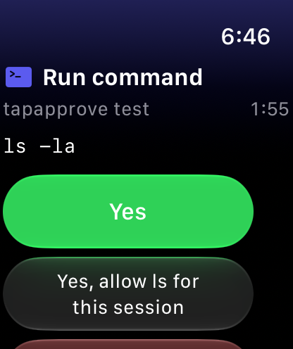

# Tapapprove

Approve Claude Code permission prompts from an Apple Watch.

An independent project, not made by or affiliated with Anthropic or Apple.



```
Claude Code ── PermissionRequest hook ── cli ──▶ relay ──▶ APNs ──▶ watch
                                          ◀──── decision ◀──────────┘
```

When Claude Code wants to ask for permission, the hook sends the request to the relay and waits. The watch shows it with the same answers as Claude Code's dialog: Yes, Yes for this session when Claude Code suggests a rule, No, and Tell Claude what to do instead. Whichever answers first wins: the watch, or the dialog, which stays open the whole time.

Claude Code's Remote Control can also notify a watch. When tested in October 2026, those notifications offered Deny, Deny with comment and Dismiss, with no Approve, and needed a Remote Control session. Tapapprove adds Yes and does not use Remote Control.

## Status

Early, and for people comfortable building from source. There is no App Store or TestFlight build yet, so you deploy your own relay and install your own copy of the watch app.

You need:

- a Mac with Xcode, [XcodeGen](https://github.com/yonaskolb/XcodeGen) and Node.js 20 or later
- an Apple Watch on watchOS 10 or later, and its iPhone
- a free Cloudflare account
- for notifications while the app is closed, a paid Apple Developer Program membership

With a free Apple account, requests appear only while the app is open, and the install lasts 7 days.

## Set it up

### 1. Deploy the relay

```sh
cd relay
npm install
cp wrangler.toml wrangler.local.toml
npx wrangler login
npx wrangler kv namespace create PAIR_CODES
```

In `wrangler.local.toml`, put the printed id under `PAIR_CODES`, and set `APNS_TOPIC` to the bundle ID you will use in step 2. Git ignores this file. Then:

```sh
npx wrangler deploy -c wrangler.local.toml   # prints your workers.dev URL
curl https://<your-url>/healthz
```

Cloudflare's free plan is enough for one person.

### 2. Install the watch app

```sh
cd watch
cp Signing.local.xcconfig.example Signing.local.xcconfig
```

Put your team ID, bundle ID and relay URL in `Signing.local.xcconfig`. Git ignores this file too. With a free Apple account, also turn on the line at the end of that file.

Turn on Developer Mode on the watch, unlock it, connect its iPhone with a cable, and run this from the repo root:

```sh
scripts/install-watch.sh
```

### 3. Turn on push

Skip this with a free Apple account. In the Apple Developer portal, create an APNs key (`.p8`), then:

```sh
cd relay
npx wrangler secret put APNS_KEY_P8 -c wrangler.local.toml < AuthKey_XXXXXXXXXX.p8
npx wrangler secret put APNS_KEY_ID -c wrangler.local.toml
npx wrangler secret put APNS_TEAM_ID -c wrangler.local.toml
```

### 4. Pair

The watch has no camera, so pairing uses a code rather than a QR scan.

1. Open Tapapprove on the watch. It shows a 6-character code, valid for 10 minutes and for one use.
2. On the computer, run `npx tapapprove pair <code> --relay https://<your-url>`. This saves the relay and token to `~/.tapapprove/config.json` (mode 600) and adds the hook to `~/.claude/settings.json`. Use `--scope project` to add it to the current project only.
3. The watch moves on by itself. Run `npx tapapprove test` to try it.

Without `--relay`, the CLI uses the maintainer's relay, which will not know a code from your own relay.

`tapapprove status` shows the state. `tapapprove unpair` removes the pairing and the hook.

## When the watch buzzes

Only when Claude Code would have asked you. It does not fire when:

- a permission rule already allows the tool, such as `Bash(ls:*)`. A plain `Bash` rule allows every command, so the watch stays silent for all of them
- Claude Code treats the action as safe on its own, such as `ls`
- the session runs in `auto` or `bypassPermissions` mode, or in `acceptEdits` for file commands like `touch` and `truncate`

An `ask` rule beats an `allow` rule and also applies in `auto` mode, so `"ask": ["Bash(git push:*)"]` sends just those commands to the watch even with a broad allow list. `AskUserQuestion` and `ExitPlanMode` stay on the computer, because they need an answer a button cannot give.

This works the same in the terminal and in the Claude panel in VS Code or Cursor.

### Use it in all your sessions

`pair` adds the hook to `~/.claude/settings.json`, so every session you start afterwards can reach the watch. Start a new session to pick it up.

If you allow most commands or work in `auto` mode, Claude Code rarely asks, so the watch stays quiet. Choose what reaches your wrist with `ask` rules in the same file:

```json
{
  "permissions": {
    "ask": ["Bash(git push:*)", "Bash(rm -rf:*)"]
  }
}
```

To check it, start a new session and paste this prompt. The folder does not exist, so nothing is deleted:

```text
Use the Bash tool to run exactly this command: rm -rf /tmp/tapapprove-try
```

The request should appear on your watch while the dialog stays open on the computer. If nothing arrives, run `npx tapapprove status` to check the pairing, the hook and push.

With the hook global, the masked text of every prompt from all your projects goes through your relay, including the content of a file being written. In a `claude -p` run there is no dialog to fall back on, so a prompt the watch does not answer within the wait (90 seconds by default) is denied.

## Safety rules

- **A failure is never an approval.** Only a real answer from the watch produces a decision. If the relay is down, the token is revoked or time runs out, the hook prints nothing and Claude Code's dialog decides.
- **Only the watch can decide.** The computer's token cannot approve its own requests.
- **No unseen approvals.** The whole request goes to the watch, and the answers come after its end, so you scroll past the text to reach them. No stays one tap away the whole time. A notification offers Yes only when it shows the whole request. A longer one offers Read & Approve, which opens the app. A request over 100,000 characters never goes to the watch, and Claude Code's dialog decides it.
- **A session answer lasts the session.** Yes, allow ... for this session uses the rule Claude Code suggested, and nothing is saved to your settings, even when Claude Code suggested saving it. The rule stays on your computer, and the watch only picks from the list. An MCP tool with no suggestion is allowed by tool name, which is broader than a rule for one site.
- **No stray taps.** A newly shown request ignores taps for 0.6 seconds, so a tap aimed at the previous one cannot approve it.
- **Secrets are masked on the computer, but never at the cost of hiding what runs.** Tokens, passwords and key-shaped strings are removed before the summary leaves the machine. A value containing anything executable, such as `$(...)` or `;`, is shown as it is, even if it reveals a secret. This is pattern matching, so an unusual secret can get through.
- **The hook runs a private copy.** `pair` copies the CLI to `~/.tapapprove/app` and the hook runs it by absolute path, so a `node_modules` planted in a project cannot replace it.

**Known limit:** in the VS Code or Cursor panel, Claude Code does not stop the hook when you answer the dialog first. The card stays on the watch until the wait runs out (90 seconds by default). Tapping it then has no effect: an approve on the watch cannot overturn a denial given in the dialog.

The relay is not end-to-end encrypted: whoever runs it can read the masked requests and could forge a decision. Run your own relay and keep its Cloudflare account secure.

## Layout

- `relay/`: Cloudflare Worker and Durable Object that broker requests between the CLI and the watch
- `cli/`: `npx` CLI and the Claude Code `PermissionRequest` hook, with no dependencies
- `watch/`: standalone watchOS 10+ SwiftUI app (XcodeGen `project.yml`), Liquid Glass on watchOS 26+
- `scripts/e2e-sim.sh`: the real app, CLI and relay together in the Simulator

## Develop locally

```sh
# Relay
cd relay
npm install
npx tsc -p .
npm test             # starts its own wrangler dev
npx wrangler dev     # http://localhost:8787

# CLI
cd cli
npm test
node bin/tapapprove.mjs pair <code> --relay http://localhost:8787

# Watch
cd watch
xcodegen
xcodebuild -project Tapapprove.xcodeproj -scheme Tapapprove -sdk watchsimulator \
  -destination 'generic/platform=watchOS Simulator' build \
  TAPAPPROVE_RELAY_URL=http://localhost:8787

# Everything together, with the relay running
scripts/e2e-sim.sh
```

The watch app reads its relay from `TAPAPPROVE_RELAY_URL` at build time, and a build without one reaches nothing. Only the Debug Info.plist allows local networking, so Release cannot ship that exception.

To try the hook without touching your real settings, pair with `--scope project` inside a scratch folder. `pair` otherwise changes the settings every Claude Code session on the machine reads.

## License

MIT. See [PRIVACY.md](PRIVACY.md) for what the app sends and keeps.
